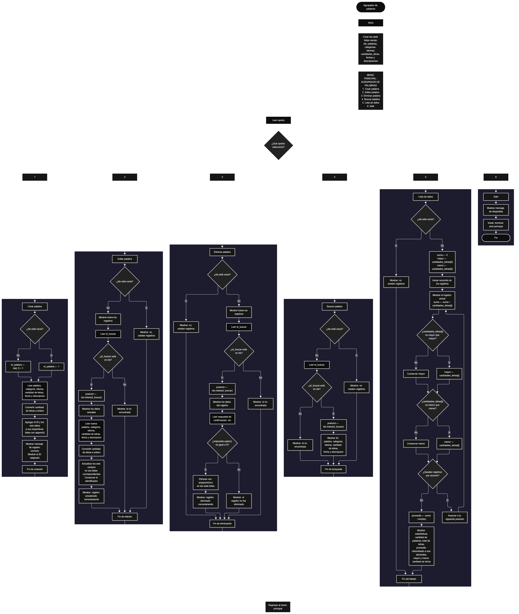

 

Este proyecto, llamado <b>agrupador de palabras</b>, fue desarrollado en <b>python</b> como un ejercicio práctico para fortalecer la lógica de programación mediante la creación de un sistema de gestión de palabras desde la consola. El programa cuenta con un menú principal de seis opciones que permite <b>crear, editar, eliminar, buscar y listar</b> las palabras registradas, además de consultar estadísticas relacionadas con la cantidad de letras de cada palabra. Cada registro almacena información como el identificador, la palabra, la categoría, el idioma, la cantidad de letras, la fecha y la descripción, utilizando siete listas paralelas que organizan los datos durante la ejecución. Durante su desarrollo se aplicaron conceptos fundamentales de programación, como variables, listas, estructuras condicionales, ciclos repetitivos, operadores de pertenencia y métodos para agregar, buscar y eliminar elementos. También se incorporaron cálculos estadísticos para obtener el total, el promedio, la mayor y la menor cantidad de letras. Este proyecto permite poner en práctica los conocimientos adquiridos en python y sirve como base para desarrollar sistemas de gestión más avanzados utilizando otros lenguajes y tecnologías.

<h2 align="center">⚙️ Funcionamiento del menú principal</h2>

### ➕ Crear palabra

La opción <b>1) crear palabra</b> permite registrar una nueva palabra en el sistema. Antes de realizar el registro, el programa comprueba si la lista <b>ids</b> está vacía mediante la condición <b>len(ids) == 0</b>. Si no existen registros, asigna el identificador inicial <b>1</b> a la variable <b>id_palabra</b>. En caso contrario, obtiene el último identificador almacenado mediante <b>ids[-1]</b> y le suma uno para generar el siguiente ID. Después, solicita la <b>palabra, categoría, idioma, cantidad de letras, fecha y descripción</b>. La cantidad de letras se convierte a un número entero mediante la función <b>int()</b>. Una vez introducidos los datos, utiliza el método <b>append()</b> para agregarlos a sus respectivas listas: <b>ids, palabras, categorias, idiomas, cantidades_letras, fechas y descripciones</b>. Finalmente, muestra el mensaje <b>"palabra registrada correctamente."</b> e informa el identificador asignado al registro. El programa no comprueba automáticamente que la cantidad de letras introducida coincida con la longitud real de la palabra.

### ✏️ Editar palabra

La opción <b>2) editar palabra</b> permite modificar la información de una palabra registrada. Primero, el programa comprueba si existen registros mediante la condición <b>len(ids) == 0</b>. Si las listas están vacías, muestra el mensaje <b>"no existen registros."</b>. En caso contrario, presenta una lista con el identificador, la palabra, la categoría, el idioma, la cantidad de letras, la fecha y la descripción de cada registro. Después, solicita el identificador que se desea editar y comprueba si existe mediante la condición <b>id_buscar in ids</b>. Si el identificador está registrado, utiliza <b>ids.index(id_buscar)</b> para obtener su posición y muestra los datos actuales de la palabra. A continuación, solicita la nueva palabra, categoría, idioma, cantidad de letras, fecha y descripción, actualizando directamente los valores de las listas correspondientes. La cantidad de letras se convierte a un número entero mediante <b>int()</b>, mientras que el identificador se conserva sin modificaciones. Finalmente, presenta el mensaje <b>"registro actualizado correctamente."</b>. Si el ID introducido no existe, muestra el mensaje <b>"id no encontrada."</b>.

### 🗑️ Eliminar palabra

La opción <b>3) eliminar palabra</b> permite eliminar una palabra registrada mediante su identificador. Antes de comenzar, el programa comprueba si existen registros. Si las listas están vacías, muestra el mensaje <b>"no existen registros."</b>. Si hay información almacenada, presenta una lista con los datos de todas las palabras. Después, solicita el identificador del registro que se desea eliminar y verifica su existencia mediante la condición <b>id_buscar in ids</b>. Si el identificador existe, obtiene su posición utilizando <b>ids.index(id_buscar)</b> y muestra la información correspondiente. A continuación, solicita confirmación mediante la pregunta <b>"¿desea eliminar este registro? (s/n):"</b>. La respuesta se convierte a mayúsculas mediante <b>respuesta.upper()</b> y se compara con la letra <b>"S"</b>. Si la respuesta es afirmativa, el programa utiliza el método <b>pop(posicion)</b> para eliminar el registro de las siete listas en la misma posición, manteniendo la correspondencia entre los datos. Finalmente, muestra el mensaje <b>"registro eliminado correctamente."</b>. Si el usuario no confirma la operación, presenta el mensaje <b>"el registro no fue eliminado."</b>. Si el identificador no existe, informa mediante el mensaje <b>"id no encontrada."</b>.

### 🔎 Buscar palabra

La opción <b>4) buscar palabra</b> permite localizar una palabra registrada mediante su identificador. Primero, el programa comprueba si existen registros almacenados. Si las listas están vacías, muestra el mensaje <b>"no existen registros."</b>. En caso contrario, solicita el identificador que se desea buscar y comprueba su existencia mediante la condición <b>id_buscar in ids</b>. Cuando encuentra el identificador, utiliza <b>ids.index(id_buscar)</b> para obtener la posición correspondiente y muestra todos los datos de la palabra: identificador, palabra, categoría, idioma, cantidad de letras, fecha y descripción. Si el identificador no se encuentra en la lista, presenta el mensaje <b>"id no encontrada."</b>. Esta función permite consultar un registro específico sin modificar la información almacenada.

### 📋 Lista de datos

La opción <b>5) lista de datos</b> permite visualizar todas las palabras registradas y consultar estadísticas relacionadas con la cantidad de letras. Antes de mostrar la información, el programa comprueba si la lista <b>ids</b> está vacía. Si no existen registros, presenta el mensaje <b>"no existen registros."</b>. Si hay palabras disponibles, inicializa la variable <b>suma</b> con el valor <b>0</b> y establece las variables <b>mayor</b> y <b>menor</b> con el primer valor de la lista <b>cantidades_letras[0]</b>. Después, utiliza un ciclo <b>for</b> para recorrer los registros, mostrar todos sus datos y acumular las cantidades de letras mediante la operación <b>suma += cantidades_letras[i]</b>. Durante el recorrido, compara cada cantidad con los valores almacenados en <b>mayor</b> y <b>menor</b> para actualizar la mayor y la menor cantidad de letras encontradas. Al finalizar, calcula el promedio mediante la operación <b>suma / len(ids)</b> y utiliza <b>round(promedio, 2)</b> para redondear el resultado a dos decimales. Finalmente, muestra las estadísticas del sistema: <b>cantidad de palabras, total de letras, promedio de letras, palabra con más letras y palabra con menos letras</b>. Los valores máximo y mínimo representan cantidades de letras, no las palabras completas que las contienen.

### 🚪 Salir del menú principal

La opción <b>6) salir</b> está destinada a finalizar la ejecución del programa. Cuando el usuario selecciona esta opción, el sistema muestra el mensaje <b>"gracias por utilizar el agrupador de palabras."</b> y ejecuta la instrucción <b>break</b>, que interrumpe el ciclo principal <b>while True</b>. De esta manera, el menú deja de repetirse y finaliza la ejecución del programa. Si el usuario introduce un valor que no coincide con ninguna de las seis opciones disponibles, el programa muestra el mensaje <b>"opción no válida."</b> y vuelve a presentar el menú principal.

<h2 align="center">🧠 Temas aplicados en el proyecto</h2>

### 📦 Variables

En este proyecto se utilizan variables para almacenar la opción seleccionada en el menú, generar identificadores, localizar registros, controlar las posiciones de las listas y calcular las estadísticas de las palabras. Cada variable cumple una función específica dentro de las operaciones de creación, edición, eliminación, búsqueda y listado. También se utilizan variables para guardar temporalmente los datos introducidos por el usuario y los resultados obtenidos durante los cálculos.

🔢 **Opcion:** Almacena la opción seleccionada por el usuario en el menú principal.

🆔 **Id_palabra:** Almacena el identificador asignado a una nueva palabra durante el registro.

🔎 **Id_buscar:** Almacena el identificador introducido por el usuario para localizar un registro.

📍 **Posicion:** Almacena la posición de un registro dentro de las listas, obtenida mediante el método <b>index()</b>.

📝 **Palabra:** Almacena temporalmente la palabra que se desea registrar.

🗂️ **Categoria:** Almacena temporalmente la categoría asociada a la palabra.

🌐 **Idioma:** Almacena temporalmente el idioma de la palabra.

🔢 **Cantidad_letras:** Almacena la cantidad de letras introducida para la palabra, convertida a un número entero.

📅 **Fecha:** Almacena temporalmente la fecha asociada al registro.

📄 **Descripcion:** Almacena temporalmente la descripción de la palabra.

✅ **Respuesta:** Almacena la respuesta del usuario para confirmar o cancelar la eliminación de un registro.

➕ **Suma:** Acumula las cantidades de letras de todos los registros durante el cálculo de las estadísticas.

📈 **Mayor:** Almacena la mayor cantidad de letras encontrada durante el recorrido de los registros.

📉 **Menor:** Almacena la menor cantidad de letras encontrada durante el recorrido de los registros.

📊 **Promedio:** Almacena el promedio de letras calculado a partir del total de letras y la cantidad de registros.

🔄 **I:** Funciona como contador en los ciclos <b>for</b> y permite acceder a las posiciones de las listas.

### 🗃️ Listas

En este proyecto se utilizan siete listas paralelas para almacenar la información de las palabras registradas. A diferencia de los arreglos de tamaño fijo, las listas de python pueden aumentar o disminuir dinámicamente mediante operaciones como <b>append()</b> y <b>pop()</b>. Cada lista almacena un campo específico y utiliza la misma posición para representar los datos de un mismo registro. Por ejemplo, la información de una palabra situada en la posición <b>0</b> se encuentra distribuida entre <b>ids[0], palabras[0], categorias[0], idiomas[0], cantidades_letras[0], fechas[0] y descripciones[0]</b>. Esta organización permite recorrer, buscar, modificar, mostrar y eliminar registros manteniendo la correspondencia entre sus datos.

🆔 **Ids:** Almacena los identificadores de las palabras registradas.

📝 **Palabras:** Almacena las palabras introducidas por el usuario.

🗂️ **Categorias:** Almacena las categorías asociadas a las palabras.

🌐 **Idiomas:** Almacena los idiomas de las palabras registradas.

🔢 **Cantidades_letras:** Almacena las cantidades de letras introducidas para cada palabra.

📅 **Fechas:** Almacena las fechas asociadas a los registros.

📄 **Descripciones:** Almacena las descripciones de las palabras.

### 🔀 Estructuras condicionales

En este proyecto se utilizan las estructuras <b>if, elif y else</b> para controlar las opciones del menú, comprobar si existen registros, determinar si un identificador está almacenado, confirmar la eliminación de una palabra y seleccionar las operaciones que deben ejecutarse. La condición <b>len(ids) == 0</b> permite detectar si no existen registros, mientras que <b>id_buscar in ids</b> comprueba si el identificador introducido está disponible. Por otro lado, la condición <b>respuesta.upper() == "S"</b> determina si el usuario confirma la eliminación. Estas estructuras permiten que el programa responda de manera diferente según el estado de los registros y las decisiones del usuario.

### 🔄 Estructuras repetitivas

En este proyecto se utilizan los ciclos <b>while</b> y <b>for</b>. El ciclo <b>while True</b> mantiene activo el menú principal y permite ejecutar diferentes operaciones hasta que el usuario selecciona la opción de salida, momento en el que se utiliza <b>break</b> para finalizar el ciclo. Por otro lado, los ciclos <b>for</b> recorren las listas para mostrar los registros existentes durante las operaciones de edición y eliminación, así como para calcular las estadísticas de las palabras. Durante el recorrido de la lista de datos, el ciclo permite acumular las cantidades de letras y determinar los valores máximo y mínimo. Estas estructuras facilitan la administración de múltiples registros sin tener que escribir instrucciones independientes para cada palabra.

### 🎯 Estructura de selección

El programa utiliza una cadena de condiciones <b>if, elif y else</b> para evaluar el valor almacenado en la variable <b>opcion</b> y ejecutar el bloque de instrucciones correspondiente. Cada condición representa una operación específica del sistema: <b>crear palabra, editar palabra, eliminar palabra, buscar palabra, lista de datos o salir</b>. La última estructura <b>else</b> funciona como alternativa cuando el usuario introduce un valor que no coincide con ninguna de las opciones definidas, mostrando el mensaje <b>"opción no válida."</b>. De esta manera, el menú principal organiza el acceso a las funcionalidades del programa.

### 🔢 Organización de los registros

El programa organiza los datos mediante siete listas paralelas que crecen dinámicamente a medida que se registran nuevas palabras. No utiliza la instrucción <b>dimension</b> ni establece una capacidad máxima fija para los registros. La cantidad de elementos almacenados se obtiene mediante <b>len(ids)</b>, mientras que la posición de cada palabra permite relacionar su identificador con la categoría, el idioma, la cantidad de letras, la fecha y la descripción. Durante la creación se utiliza <b>append()</b> para agregar los datos y, durante la eliminación, se utiliza <b>pop(posicion)</b> en todas las listas para retirar los elementos correspondientes. Esta organización permite administrar los registros sin establecer un límite fijo de posiciones.

### 🔄 Reorganización de registros

Cuando se selecciona una palabra para eliminarla, el programa obtiene su posición mediante <b>ids.index(id_buscar)</b>. Después, utiliza el método <b>pop(posicion)</b> para eliminar el elemento correspondiente de cada una de las siete listas. Al realizar la eliminación en la misma posición, los datos de los registros restantes conservan su correspondencia y las listas reducen automáticamente su tamaño. A diferencia de un sistema que desplaza manualmente los elementos mediante un ciclo, este programa utiliza directamente el método <b>pop()</b> para reorganizar los registros. El identificador de los elementos restantes no se modifica, aunque la posición que ocupan en las listas puede cambiar.

<h2 align="center">¿Cómo se implementaron las operaciones crud en el proyecto?</h2>

Las operaciones <b>crud</b> se implementaron mediante las opciones del menú principal, permitiendo administrar las palabras registradas. La operación <b>crear</b> corresponde a <b>crear palabra</b>, donde se introducen los datos de un nuevo registro y se agregan a las listas mediante <b>append()</b>. La operación <b>leer</b> se realiza mediante las opciones <b>buscar palabra y lista de datos</b>, que permiten consultar un registro específico o visualizar todos los registros junto con sus estadísticas. La operación <b>actualizar</b> corresponde a <b>editar palabra</b>, donde se localiza el registro por su identificador y se modifican sus campos de información. Finalmente, la operación <b>eliminar</b> se realiza mediante <b>eliminar palabra</b>, que solicita confirmación y utiliza <b>pop()</b> para retirar los datos de las listas. Estas operaciones utilizan variables, listas, condicionales, ciclos y métodos de python para gestionar la información almacenada temporalmente durante la ejecución del programa.

<h2 align="center">Diagrama de flujo del proyecto</h2>

<h2 align="center">🛡️ Validaciones del programa</h2>

### 📭 No existen registros

Esta validación se utiliza en las opciones de <b>editar, eliminar, buscar y lista de datos</b>. El programa comprueba si la lista <b>ids</b> está vacía mediante la condición <b>len(ids) == 0</b>. Si no existen palabras registradas, muestra el mensaje <b>"no existen registros."</b> y evita continuar con las operaciones que necesitan información almacenada. Esta comprobación permite controlar el acceso a las funciones de gestión cuando todavía no se ha registrado ninguna palabra.

### ❌ Identificador no encontrado

Esta validación se utiliza durante las operaciones de <b>editar, eliminar y buscar palabra</b>. El programa comprueba si el identificador introducido se encuentra en la lista <b>ids</b> mediante la condición <b>id_buscar in ids</b>. Si el identificador existe, obtiene su posición mediante <b>ids.index(id_buscar)</b> y continúa con la operación seleccionada. Si no se encuentra, muestra el mensaje <b>"id no encontrada."</b>. Esta comprobación evita intentar acceder a un registro que no está almacenado en las listas.

### ⚠️ Confirmación de eliminación

Esta validación se utiliza en la opción <b>eliminar palabra</b>. Antes de retirar los datos de las listas, el programa solicita al usuario que confirme la operación mediante una respuesta de tipo texto. La condición <b>respuesta.upper() == "S"</b> permite aceptar tanto la letra mayúscula como la minúscula. Si la respuesta es afirmativa, elimina el registro de las siete listas mediante <b>pop(posicion)</b>. En caso contrario, muestra el mensaje <b>"el registro no fue eliminado."</b> y conserva los datos almacenados.

### 🔢 Cantidad de letras

Durante la creación y edición de una palabra, el programa utiliza la función <b>int()</b> para convertir la cantidad de letras introducida por el usuario en un número entero. Sin embargo, el código no comprueba que el valor introducido coincida con la longitud real de la palabra ni incorpora un control de errores para entradas que no puedan convertirse a entero. Por este motivo, la cantidad de letras almacenada depende del valor introducido por el usuario, y una entrada no numérica puede interrumpir la ejecución del programa.

### ⚠️ Opción inválida

La estructura condicional del menú incluye un bloque <b>else</b> que muestra el mensaje <b>"opción no válida."</b> cuando el usuario introduce una opción que no corresponde a ninguno de los seis casos definidos. Después de mostrar el mensaje, el ciclo <b>while True</b> continúa y presenta nuevamente el menú principal. Esta validación permite mantener el acceso a las operaciones disponibles cuando se introduce una selección incorrecta.

<h2 align="center">🎯 Objetivo del proyecto</h2>

El objetivo principal de este proyecto es fortalecer la <b>lógica de programación</b> mediante el desarrollo de un sistema de gestión de palabras en <b>python</b>. A través de su construcción se busca aplicar los conocimientos adquiridos sobre variables, listas, estructuras condicionales, ciclos repetitivos, operadores de pertenencia y métodos de manipulación de datos, integrándolos para resolver un problema de manera organizada. Además, el proyecto permite comprender cómo registrar, consultar, modificar y eliminar información, así como calcular estadísticas a partir de los datos almacenados en una aplicación de consola. De esta manera, se establece una base para desarrollar sistemas de gestión más completos utilizando otros lenguajes y tecnologías.

